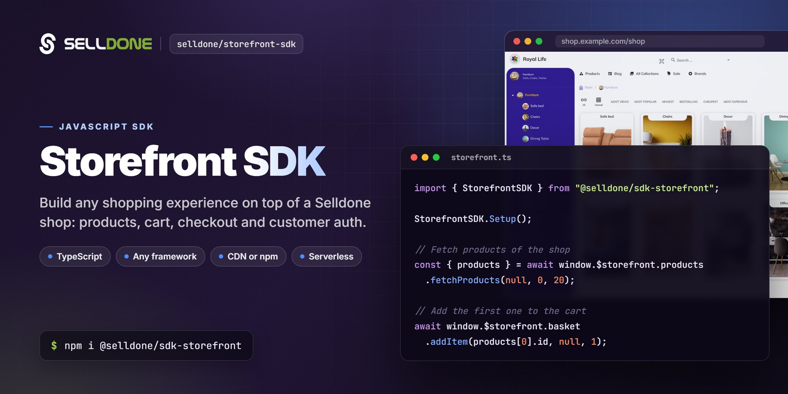
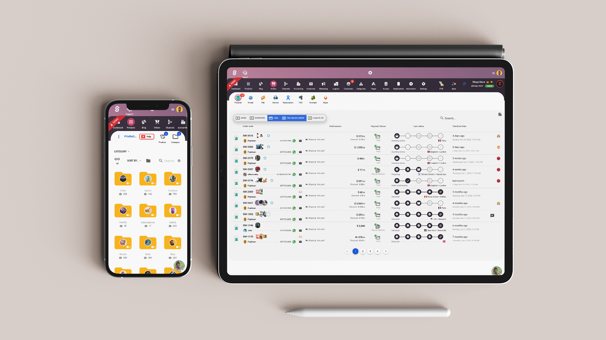
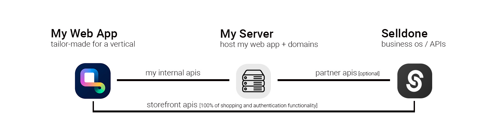
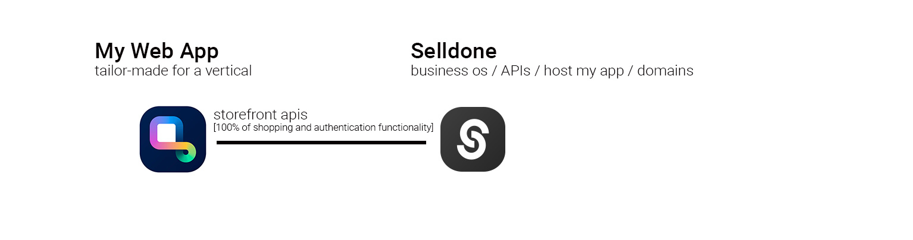

<p align="center">
  
</p>

<p align="center">
  <a href="https://www.npmjs.com/package/@selldone/sdk-storefront"></a>
  <a href="https://www.npmjs.com/package/@selldone/sdk-storefront"></a>
  <a href="LICENSE.md"></a>
  <a href="https://github.com/selldone/storefront-sdk/wiki"></a>
  <a href="https://selldone.com"></a>
</p>

<p align="center">
  <b>A TypeScript client for the Selldone storefront API (XAPI): build a custom shop front end in Vue, React, plain HTML or any other stack, with no backend to run.</b><br>
  <a href="https://github.com/selldone/storefront-sdk/wiki">Documentation</a> ·
  <a href="#quick-start">Quick start</a> ·
  <a href="https://github.com/selldone">Ecosystem</a> ·
  <a href="https://selldone.com">Selldone.com</a> ·
  <a href="https://github.com/selldone/storefront-sdk/issues">Report an issue</a>
</p>

<p align="center">
  <a href="https://github.com/selldone/storefront">Storefront</a> ·
  <a href="https://github.com/selldone/pagebuilder">Page Builder</a> ·
  <a href="https://github.com/selldone/components">Components</a> ·
  <b><a href="https://github.com/selldone/storefront-sdk">Storefront SDK</a></b> ·
  <a href="https://github.com/selldone/backoffice-sdk">Backoffice SDK</a> ·
  <a href="https://github.com/selldone/vendor-sdk">Vendor SDK</a> ·
  <a href="https://github.com/selldone/community-sdk">Community SDK</a> ·
  <a href="https://github.com/selldone/core">Core</a> ·
  <a href="https://github.com/selldone/cli">CLI</a> ·
  <a href="https://github.com/selldone/translate">Translate</a>
</p>

## Overview

**Selldone® Storefront SDK** (`@selldone/sdk-storefront`) connects any web front end to a shop created on **Selldone Business OS**. It reads your shop name and API endpoints from `<meta>` tags, configures an HTTP client with the right customer, guest and campaign headers, and exposes a typed API under one global object: `window.$storefront`.

With it you can list and search products, show product details, sign customers in with an email or SMS one-time password, manage the basket, load coupons, offers, cashback and lottery prizes, and more. Products, orders, payments, inventory and customers are all handled by Selldone, so your project stays a pure front-end application.

The SDK is framework-agnostic. It is the data layer of the official [Storefront](https://github.com/selldone/storefront) (Vue 3), the [Storefront Playground](https://github.com/selldone/storefront-playground) starter and the [Page Builder](https://github.com/selldone/pagebuilder), and it works equally well from a single `<script>` tag on a static HTML page.

Use it if you want to build a custom storefront, a niche shopping experience, a widget that shows live products on another website, or a SaaS product on top of Selldone shops.

## Key features

- **One global API** — `StorefrontSDK.Setup()` creates `window.$storefront` with namespaces for `products`, `basket`, `auth`, `user`, `shop`, `coupon`, `offer`, `cashback`, `lottery`, `vendor`, `avocado`, `article`, `database`, `currency` and `routes`.
- **Configuration by meta tags** — shop name, path prefix, custom home page, API and CDN endpoints are read from `<head>`; no build-time secrets.
- **Product catalog** — paginated listing with search, sort, category, tag, vendor, price range, brand, variant and location filters, plus product details, ratings and subscription content.
- **Basket** — add and remove items with variants, preferences, marketplace vendor products and subscription prices.
- **Passwordless customer login** — email OTP and SMS OTP flows (including new-user registration and account selection) and logout.
- **Built-in response cache** — `optimize(seconds)`, `.cache(callback)`, `force()` and `cancellation()` give instant UI from cached data and avoid duplicate requests.
- **Guest checkout ready** — guest code, referrer, campaign, affiliate, email-marketing and popup headers are attached to every request automatically.
- **Currency and language helpers** — persisted per shop in local storage, with exchange rates and shop language packs.
- **TypeScript first** — every call has typed options and responses built on the shared models in [`@selldone/core-js`](https://github.com/selldone/core).
- **npm or CDN** — ES module, CommonJS and a minified browser bundle (`dist/bundle.min.js`).

## Screenshots

<p align="center">
  
</p>

## Quick start

**1. Install**

```bash
npm install @selldone/sdk-storefront
```

```bash
yarn add @selldone/sdk-storefront
```

**2. Add the meta tags** to the `<head>` of your HTML page (replace `toysworld` with your shop name; the full list is in [Add meta tags to HTML](#add-meta-tags-to-html)).

```html
<meta name="shop-name" content="toysworld">
<meta name="shop-prefix-address" content="">
<meta name="custom-home" content="shop">
```

**3. Set up the SDK and fetch products**

```javascript
import { StorefrontSDK } from "@selldone/sdk-storefront";

// ━━━ Storefront SDK (xapi,...) ━━━
StorefrontSDK.Setup(); // Set up the Shop SDK.

window.$storefront.products
  .list(null, 0, 10, { sort: "newest" }) // category, offset, limit, options
  .then(({ products, folders }) => {
    console.log(products, folders);
  })
  .catch((error) => console.error(error));
```

`StorefrontSDK.Setup()` also initializes [Selldone Core](https://github.com/selldone/core) (`SelldoneCore.Setup()`) automatically if you have not done it yourself.

## Usage

### Use in Vue, React, Bootstrap, or any other JS framework

```javascript
import { StorefrontSDK } from "@selldone/sdk-storefront";

// ━━━ Storefront SDK (xapi,...) ━━━
StorefrontSDK.Setup(); // Set up the Shop SDK.
```

You can initialize Selldone Core explicitly first, for example to pass your i18n instance:

```javascript
// ━━━ Selldone Core (gapi,...) ━━━
import { SelldoneCore } from "@selldone/core-js";
SelldoneCore.Setup();

// ━━━ Storefront SDK (xapi) ━━━
import { StorefrontSDK } from "@selldone/sdk-storefront";
StorefrontSDK.Setup(); // Set up the Shop SDK.
```

`Setup()` accepts two optional arguments: a shop name (overrides the `shop-name` meta tag; required when the SDK runs inside a Backoffice SDK environment) and an options object `{ cookie_key_access_token }` (default `"access_token"`), the cookie that stores the customer access token.

### Use in HTML

```html
<script src="https://cdn.jsdelivr.net/npm/@selldone/sdk-storefront@{version}/dist/bundle.min.js"></script>
<script>
    // Use the global variable StorefrontSDK
    const sdk = storefront.StorefrontSDK;
    sdk.Setup()
</script>
```

Change `{version}` to the latest version: <a href="https://www.npmjs.com/package/@selldone/sdk-storefront"></a>

**Other CDN options**

You can always fetch the latest version of `@selldone/sdk-storefront` using jsDelivr's latest version alias:

```html
<script src="https://cdn.jsdelivr.net/npm/@selldone/sdk-storefront@latest/dist/bundle.min.js"></script>
```

If you prefer unpkg:

```html
<script src="https://unpkg.com/@selldone/sdk-storefront/dist/bundle.min.js"></script>
```

> [!WARNING]
> Using `@latest` can sometimes break your app if new versions introduce breaking changes. If stability is a concern, specify a fixed version or use semantic versioning, for example:
>
> ```html
> <script src="https://cdn.jsdelivr.net/npm/@selldone/sdk-storefront@1/dist/bundle.min.js"></script>
> ```

### Add meta tags to HTML

To integrate your web application with the Selldone ecosystem, embed these meta tags in the `<head>` section of your HTML. They let the SDK connect to the Selldone API and retrieve your shop's data.

```html
<!-- 🏬 Shop Name -->
<meta name="shop-name" content="toysworld">

<!-- 🎗 Prefix address of app Ex./my-shop-path -->
<meta name="shop-prefix-address" content="">

<!-- 📰 Shop custom page -->
<meta name="custom-home" content="shop">


<!-- ―――――――――――――――― Start ❯ Business OS Configuration ―――――――――――――――― -->

<!-- 🪁 Service Origin -->
<meta content="https://selldone.com" name="service-url">


<!-- 🎯 APIs -->
<meta content="https://gapi.selldone.com" name="selldone-gapi">
<meta content="https://xapi.selldone.com" name="selldone-xapi">
<meta content="https://iframe.selldone.com" name="selldone-iframe">
<meta content="https://capi.selldone.com" name="selldone-capi">

<!-- 🌍 CDNs -->
<meta content="https://selldone.com/cdn-shop-images-1" name="selldone-cdn-images">
<meta content="https://selldone.com/cdn-shop-jsons-1" name="selldone-cdn-jsons">
<meta content="https://selldone.com/cdn-videos" name="selldone-cdn-videos">
<meta content="https://selldone.com/cdn-shop-temp-files" name="selldone-cdn-temp-files">
<meta content="https://selldone.com/cdn-ar" name="selldone-cdn-ar">
<meta content="https://selldone.com/cdn-id" name="selldone-cdn-id">
<meta content="true" name="storage-redirect">
<meta content="https://cdn.selldone.com" name="storage-redirect-host">
<meta content="true" name="storage-redirect-thumbnails">
```

When your Layout is hosted on Selldone these tags are injected for you. See [Setup and Meta Tags](https://github.com/selldone/storefront-sdk/wiki/Setup-and-Meta-Tags) for what each tag does and which ones are required.

### The `window.$storefront` API

| Namespace | What it does | Guide |
|---|---|---|
| `products` | `list()`, `get()`, `rate.submitMyRate()`, `subscription.getContents()` | [Products](https://github.com/selldone/storefront-sdk/wiki/Products) · [product/](product) |
| `basket` | `addItem()`, `deleteItem()` | [Basket and Checkout](https://github.com/selldone/storefront-sdk/wiki/Basket-and-Checkout) · [basket/](basket) |
| `auth` | `email.requestOtp()`, `email.verifyOTP()`, `sms.requestOTP()`, `sms.verifyOTP()`, `sms.registerUser()`, `sms.selectUser()`, `logout()` | [Authentication](https://github.com/selldone/storefront-sdk/wiki/Authentication) · [auth/](auth) |
| `user` | `fetchMyInfo()`, `setUserCurrency()`, `setFcmToken()`; current user in `USER` | [Customer Account](https://github.com/selldone/storefront-sdk/wiki/Customer-Account) |
| `shop` | `fetchShop()`, `exchange.fetchRates()`, `language.fetchLanguagePack()` | [Customer Account](https://github.com/selldone/storefront-sdk/wiki/Customer-Account) |
| `coupon`, `offer`, `cashback`, `lottery` | Eligible coupons, offers, cashback programs and won lottery prizes | [Coupons, Offers, Cashback and Lottery](https://github.com/selldone/storefront-sdk/wiki/Coupons-Offers-Cashback-Lottery) |
| `vendor`, `avocado`, `article` | Marketplace vendor info, Avocado orders, article tags | [API Reference](https://github.com/selldone/storefront-sdk/wiki/API-Reference) |
| `database`, `currency` | Per-shop local storage (coupon codes, currency, language) and the selected currency | [Customer Account](https://github.com/selldone/storefront-sdk/wiki/Customer-Account) |
| `routes`, `name`, `prefix_url`, `home` | Route names of the official Storefront, shop name, path prefix and custom home | [API Reference](https://github.com/selldone/storefront-sdk/wiki/API-Reference) |

### Fetch products with caching

```javascript
window.$storefront.products
  .optimize(600) // Serve from cache for 600 seconds
  .list(null, 0, 10, {
    categories_count: 10,
    with_parent: true,
    with_total: true,
    sort: "most_popular",
    search: null,
    filter: JSON.stringify({ only_has_discount: true }), // Sent as a JSON string, as the official components do
  })
  .cache(({ products }) => {
    // Called first with cached data (if any). Always call cache() before then().
  })
  .then(({ products, folders, parent, total }) => {
    // Fresh data from the server (or cached data within the optimize window)
  })
  .catch((error) => {
    // Log error
  });
```

### Product details and add to basket

```javascript
const { product } = await window.$storefront.products.get(12345, { no_article: true });

const { basket, bill, error, error_msg } = await window.$storefront.basket.addItem(
  product.id,
  null, // variant_id
  1,    // count
);
```

### Customer login with email OTP

```javascript
// Step 1: send a one-time password
await window.$storefront.auth.email.requestOtp("jane@example.com");

// Step 2: verify it and receive an access token
const { token, expires_in } = await window.$storefront.auth.email.verifyOTP(
  "jane@example.com",
  "123456",
  "customer", // Customer.Source
);
```

See [Authentication](https://github.com/selldone/storefront-sdk/wiki/Authentication) for storing the token, SMS login and logout.

### Use the SDK in Page Builder sections

The [`standalone/`](standalone) folder contains a ready-to-paste Vue snippet (products carousel) for the Page Builder *Raw HTML* section. Live code: https://codepen.io/pajuhaan/pen/JjqGBWJ. See [Page Builder Snippets](https://github.com/selldone/storefront-sdk/wiki/Page-Builder-Snippets).

### Articles & live samples

- **Medium article:** [Build E-Commerce with Open-Source Selldone — Fetch List of Products + Vue3 Sample](https://pajuhaan.medium.com/build-e-commerce-with-open-source-selldone-fetch-list-of-products-vue3-sample-9e61108b0ca6)
- **Live sample code:** https://codepen.io/pajuhaan/pen/pomvQWr
- **Starter project:** [selldone/storefront-playground](https://github.com/selldone/storefront-playground)
- **Full production storefront:** [selldone/storefront](https://github.com/selldone/storefront)

### Build SaaS solutions with the SDK

The SDK and Selldone components let you build specialized e-commerce solutions for any industry and sell them as SaaS products, without writing backend code. For example, a subscription service for marketing analysis, or a platform for selling training courses, all powered by Selldone. Even with a few months of JavaScript and HTML experience you can build a fully customized online store in a day.

#### Case study 1: Host the web app on your own backend

1. Create an app with Selldone components.
2. Develop a website with a home page and onboarding.
3. Define subscription plans, code to sell subscriptions, and host the web app.
4. Users subscribe, connect their Selldone shop, and offer their services.



#### Case study 2: Host the web app on Selldone

1. Create a custom web app with Selldone components.
2. Register and verify as a SaaS owner on Selldone.
3. Deploy the web app on Selldone and charge users via Selldone's subscription service.



More details: [SaaS Hosting Strategies](https://github.com/selldone/storefront-sdk/wiki/SaaS-Hosting-Strategies).

### Storefront build guide (any framework)

[`ai-guideline/`](ai-guideline) is a source-derived guide pack for building a full-featured Selldone storefront in any framework: architecture, routes, the full XAPI endpoint catalog, UI patterns, a feature checklist and checkout deep-dives. [`AI.md`](AI.md) is a condensed instruction set for code-generation tools. Both are written so that developers and automated tooling can rebuild the official Storefront behavior with any UI.

## Documentation

| Page | What you'll learn |
|---|---|
| [Home](https://github.com/selldone/storefront-sdk/wiki) | What the SDK is, page map and where it fits. |
| [Getting Started](https://github.com/selldone/storefront-sdk/wiki/Getting-Started) | Install, meta tags, first working product list. |
| [Setup and Meta Tags](https://github.com/selldone/storefront-sdk/wiki/Setup-and-Meta-Tags) | npm vs CDN, every meta tag, `Setup()` options, request headers. |
| [Authentication](https://github.com/selldone/storefront-sdk/wiki/Authentication) | Email and SMS OTP login, registration, storing the token, logout. |
| [Products](https://github.com/selldone/storefront-sdk/wiki/Products) | List, filter, sort, product details, ratings, subscription content, caching. |
| [Basket and Checkout](https://github.com/selldone/storefront-sdk/wiki/Basket-and-Checkout) | Add and remove items, bills, guest baskets, checkout endpoints. |
| [Customer Account](https://github.com/selldone/storefront-sdk/wiki/Customer-Account) | Current user, shop info, currency, language, local database. |
| [Coupons, Offers, Cashback and Lottery](https://github.com/selldone/storefront-sdk/wiki/Coupons-Offers-Cashback-Lottery) | Incentive APIs and saved coupon codes. |
| [API Reference](https://github.com/selldone/storefront-sdk/wiki/API-Reference) | Every namespace and method with signatures. |
| [Page Builder Snippets](https://github.com/selldone/storefront-sdk/wiki/Page-Builder-Snippets) | Use the SDK inside Page Builder Raw HTML sections. |
| [SaaS Hosting Strategies](https://github.com/selldone/storefront-sdk/wiki/SaaS-Hosting-Strategies) | Self-hosted vs hosted-on-Selldone business models. |
| [FAQ](https://github.com/selldone/storefront-sdk/wiki/FAQ) | Common questions and troubleshooting. |

Module-level notes also live next to the code: [`auth/`](auth), [`product/`](product), [`basket/`](basket), [`apis/`](apis).

## How it fits in the ecosystem

The Storefront SDK is the customer-facing API layer of Selldone. It builds on [Selldone Core](https://github.com/selldone/core) (models, enums, HTTP base class) and is used by the [Storefront](https://github.com/selldone/storefront) app, [Components](https://github.com/selldone/components) and the [Page Builder](https://github.com/selldone/pagebuilder). Admin dashboards use the [Backoffice SDK](https://github.com/selldone/backoffice-sdk) instead, and the [CLI](https://github.com/selldone/cli) deploys your finished storefront as a Layout on Selldone.

<p align="center">
  <a href="https://github.com/selldone#ecosystem"></a>
</p>

### Related projects

| Project | Why it is relevant |
|---|---|
| [storefront](https://github.com/selldone/storefront) | Production-ready Vue 3 + Vite storefront built on this SDK. |
| [storefront-playground](https://github.com/selldone/storefront-playground) | Minimal Storefront SDK starter (Vue 3 + Vite). |
| [core](https://github.com/selldone/core) | Shared models, types, enums and helpers used by the SDK. |
| [components](https://github.com/selldone/components) | Pre-built Vue 3 commerce components for storefront and backoffice. |
| [community-sdk](https://github.com/selldone/community-sdk) | Community (posts, topics) API client for the same storefront. |
| [cli](https://github.com/selldone/cli) | Build, zip and deploy a Layout to Selldone. |

## Contributing

Contributions are welcome. Please read the organization [contributing guide](https://github.com/selldone/.github/blob/main/CONTRIBUTING.md) and [code of conduct](https://github.com/selldone/.github/blob/main/CODE_OF_CONDUCT.md).

Local development notes are in [DEVELOPMENT.md](DEVELOPMENT.md). In short:

```bash
yarn link                       # link this library into your app
yarn link "@selldone/core-js"   # use a local clone of Selldone Core
yarn build                      # tsc -p sdk-tsconfig.json
yarn bundle                     # rollup: dist/bundle(.min).js, index.esm.js, index.cjs
```

Tests use [Vitest](https://vitest.dev) with `jsdom` (run `npx vitest`); [`tests/SetupTests.ts`](tests/SetupTests.ts) injects the meta tags the SDK needs, and the sample tests in [`product/list/`](product/list) call the live storefront API of a demo shop. Each module keeps its request functions in its own folder with typed `I…Response` / `IOptions` namespaces; follow the same pattern for new endpoints.

Original author: Mehrdad Pajuhaan.

## Security

Please do not report security vulnerabilities in public issues. Follow the organization [security policy](https://github.com/selldone/.github/blob/main/SECURITY.md) and email **security@selldone.com**.

## License

See [LICENSE.md](LICENSE.md) for this repository's license file.

<details>
<summary>Selldone Ecosystem License Agreement</summary>

**Selldone Ecosystem License Agreement**

1. **Scope of License**: This license is granted exclusively for the use of the enclosed code (hereinafter referred to
   as "the Code") within the Selldone ecosystem. The licensee is authorized to use the Code solely in conjunction with
   services and applications that are part of, or directly related to, the Selldone ecosystem.

2. **Commercial Use Restriction**: The licensee is strictly prohibited from using the Code for any commercial purposes
   outside the Selldone ecosystem. Commercial utilization is permissible only when it is within the Selldone ecosystem
   and in accordance with the terms of this agreement.

3. **Permission for Free Use**: The Code may be used for non-commercial, free services, provided that explicit credit is
   given to Selldone. This credit must include the name "Selldone" prominently displayed on the user interface of the
   relevant service or application, along with a hyperlink to [selldone.com](https://selldone.com).

4. **No Redistribution**: The licensee may not redistribute the Code, in whole or in part, to any third party outside
   the Selldone ecosystem, unless expressly authorized by Selldone.

5. **No Modification for Redistribution**: While modifications to the Code for personal or internal use within the
   Selldone ecosystem are allowed, the licensee may not modify the Code for the purpose of redistribution outside the
   Selldone ecosystem.

6. **Termination**: Failure to comply with the terms of this agreement will result in the immediate termination of the
   license and may subject the licensee to legal action.

7. **Disclaimer of Warranty**: The Code is provided "as is" without any warranties of any kind, either expressed or
   implied, including but not limited to implied warranties of merchantability or fitness for a particular purpose.

8. **Limitation of Liability**: In no event shall Selldone be liable for any damages arising out of the use or inability
   to use the Code.

9. **Jurisdiction and Disputes**: This agreement shall be governed by the laws of the jurisdiction where Selldone is
   established. Any disputes arising from this agreement shall be resolved in the courts of that jurisdiction.

By using the Code, the licensee acknowledges that they have read, understood, and agreed to the terms of this license.

</details>

---
<p align="center"><sub>Part of the <a href="https://github.com/selldone">Selldone® Business OS</a> open-source ecosystem · <a href="https://selldone.com">selldone.com</a></sub></p>
